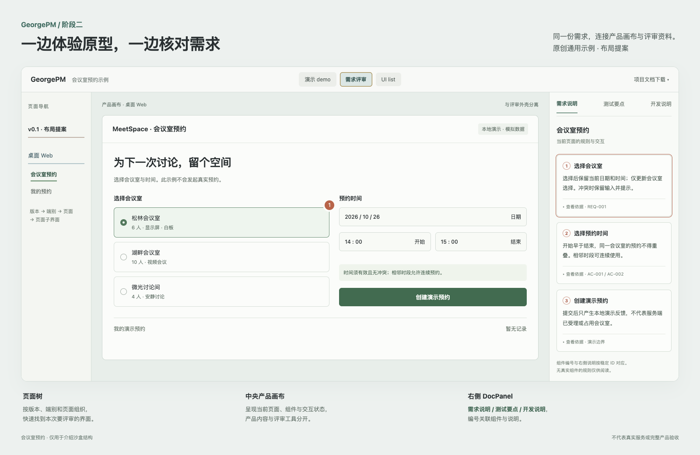
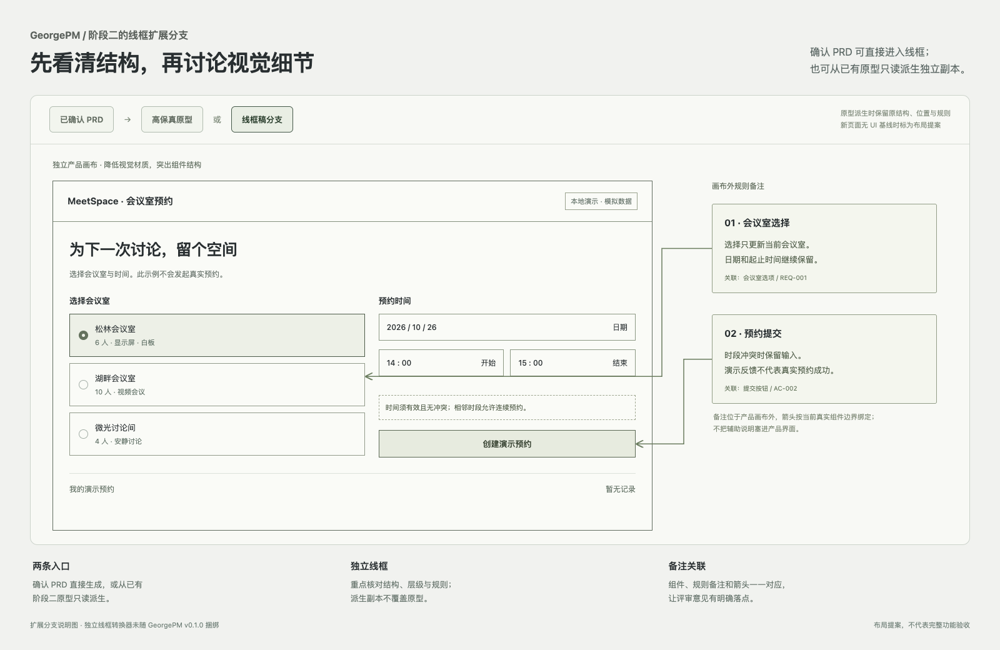

# 阶段二配图说明

这两张图使用同一个原创“会议室预约”场景，介绍阶段二的两种产物方向。图中的页面、字段和文案是公开演示内容，不取自业务项目，也不作为真实服务或完整功能已验收的证据。

## 高保真沙盒分屏

- 顶部工具栏：提供沙盒查看与评审入口。
- 左侧页面树：在版本、端别和页面层级中找到当前视图。
- 中央产品画布：体验当前页面及组件状态。
- 右侧说明：分为需求说明、测试要点、开发说明；组件标注与说明对应。

这是通用布局示例，不把固定尺寸或配色推广为所有项目要求。实际平台、页面范围、视觉基线与交互仍依据项目确认材料。

## 线框稿分支

线框分支与高保真分支并列，不是高保真沙盒中的第四种查看模式。常见输入有两种：

1. **确认 PRD → 独立线框**：先核对需求、范围和 UI 来源；没有既有 UI 的新页面标为布局提案。
2. **已有原型 → 只读派生线框**：保留源视图的结构、位置、尺寸和规则，降低视觉材质，不改写原型。

备注卡位于产品画布外，箭头对应真实组件；备注不是产品页面的一部分。本图是会议室场景的布局提案，不宣称还原某份现有业务 UI。

## 包能力与图片边界

GeorgePM v0.1.0 提供 `pm-define`、`pm-prototype`、`pm-deliver` 三个 Skill。配图补充了沙盒布局与线框扩展路线的介绍，没有增加第四个 Skill；独立线框生产器及一键转换器不在本包内。

图片说明与 Skill 指引不能替代真实宿主安装、浏览器交互、来源保真或生产服务验证。会议室的三阶段文字契约见 [示例目录](../examples/meeting-room/README.md)。

## 图片来源

两张 PNG 均由本项目原创 HTML 介绍页在浏览器实际渲染后截取，尺寸为 1600 × 1040；内容是布局示意，不是宿主安装截图或独立线框转换器的输出。图片遵循本仓库 MIT 许可。
